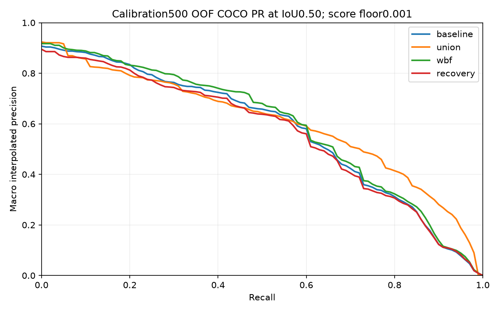

# Stage F: E4 calibration-only fusion feasibility — 2026-09-24

**Decision: reject E4 fusion and retain E1 YOLOv8s.** The bounded search is complete. No candidate passed the preregistered out-of-fold improvement gate. The strongest candidate was E1-anchored asymmetric WBF, but its AP50:95 gain was **0.0096027013** (0.96027013 percentage points), below the required **0.01**. Macro class F1 improved **0.0085297550**, below0.02. Neither precision nor recall reached0.70. No further parameter search was performed.

## F1: integrity and immutable protocol

Verified selected E1 epoch22 SHA `9f1045381024445b50e33539791da224b732d61781c73b347013477ebb077fab`, E3 epoch13 SHA `2d035a95206475b1e9939c5686a731a2427f84918389a2aa4d59148ed5ba5df9`, calibration500/mapping hashes and both Stage E prediction bundles. E1 prediction SHA `7389243341d9c945e2307ae99cdfd42435bf8949bbe607546db65eda5f7bdbcc`; E3 `1db478fb2bfdab67c3378c3cf02d5b6d6f72809c8231be79649485496c08727c`. GT labels were reconstructed only from the hash-verified calibration allowlist and compared between detectors; no inference was used for CV.

Parent Stage E canonical hash `2d15fd4edde67eb07b8ddf5b6e1090204fdda28a2b2b4601f366ea8e95f6c199` remains unchanged. New [Stage F protocol](../../reports/accuracy_stage_f/protocol.json) canonical SHA **`7cddd248587f612a0f1e0852799e7dbead93c0202fe7bb8d2983d92ab3144f7a`** was written before scoring candidates. [Integrity/preservation evidence](../../reports/accuracy_stage_f/integrity.json) and [validation](../../reports/accuracy_stage_f/validation.json) confirm **138** historical files unchanged. Reserved1500 manifest/images/annotations were **not opened, enumerated, hashed, previewed or evaluated**. Recording the previously known parent protocol hash does not access reserved data.

## F2/F3: bounded search and fold separation

Seed42, sorted image IDs shuffled then stride-five partition: five held-out folds of100 images and training portions of400. [Exact fold IDs](../../reports/accuracy_stage_f/folds.json). Each family's parameters, operating threshold and supported/weak-class logic were fitted only on that fold's400 training images, then evaluated on its100 held-out images. Independent deterministic regeneration matched all20 selected fold/family prediction hashes. [Selections](../../reports/accuracy_stage_f/fold_selections.json), [reproducibility](../../reports/accuracy_stage_f/reproducibility.json).

Exactly **19 parameter configurations ×9 operating thresholds ×5 folds =855 training-search rows**:

- E1 baseline: unchanged low-confidence predictions; its operating threshold is also selected on training folds from the same grid.
- Class-aware union+NMS: IoU0.45/0.55/0.65; raw confidence scores, stable ties, max300.
- Asymmetric E1-anchored WBF: the three IoUs × paired weights(0.70,0.30)/(0.85,0.15). Pair each E1 box with at most one unused same-class E3 box; confidence-weighted coordinates and model-weighted confidence. Unmatched E1 is unchanged; unmatched E3 is not added.
- E1-primary recovery: three IoUs × E3 addition thresholds0.35/0.45/0.55. Preserve all E1 predictions; additions must not overlap any-class E1 anchors with confidence≥0.20 or previous additions. At max300, never evict E1. Classes with training-fold GT support<100 get E1-only behavior; otherwise E3 classes weaker than E1 by training AP50:95 require at least0.55 confidence.

The final threshold grid is **0.20:0.05:0.60**. Maximize training macro class F1;12-decimal ties prefer higher operating threshold, larger E1 weight, higher addition threshold, lower IoU, then lexical ID. No learned score calibration or rare-class-specific tuning was performed. The E3 addition grid applies only to recovery, and paired weights apply only to WBF; no irrelevant Cartesian combinations were searched. [Complete search table](../../reports/accuracy_stage_f/training_search.csv).

## F4: pooled out-of-fold calibration metrics

Common evaluator unchanged: COCO IoUs0.50:0.05:0.95, AP score floor0.001, maxDets[1,10,300], same14 classes, original-pixel areas and absent-class exclusion. AP integrates all low-floor OOF predictions. Fixed metrics use each image's training-selected fold threshold and class-aware IoU0.50 matching; harmonic F1 combines macroP/R, macro class F1 averages class F1. Confusion uses separate class-agnostic matching. This avoids incorrectly filtering AP at the operating threshold.

| Family | Precision | Recall | Harmonic F1 | Macro class F1 | AP50 | AP50:95 |
|---|---:|---:|---:|---:|---:|---:|
| baseline | 0.620449 | 0.567724 | 0.592917 | 0.586175 | 0.573778 | 0.482829 |
| union | 0.567557 | 0.599196 | 0.582947 | 0.577425 | 0.602022 | 0.466011 |
| wbf | 0.629163 | 0.576337 | 0.601592 | 0.594705 | 0.588813 | 0.492432 |
| recovery | 0.598731 | 0.574964 | 0.586607 | 0.578801 | 0.558814 | 0.467179 |

E1's AP reproduces Stage E exactly. Its P/R/F1 differ because the earlier single calibration-selected0.34 threshold is replaced by training-fold-only thresholds on the mandated Stage F grid. Compare fusion with this **OOF E1 baseline**, not earlier fixed operating points.

Fold mean ± sample standard deviation (five held-out folds; not confidence intervals):

| Family | Precision | Recall | Macro class F1 | AP50:95 |
|---|---:|---:|---:|---:|
| baseline | 0.6116 ± 0.0417 | 0.5638 ± 0.0205 | 0.5757 ± 0.0137 | 0.4939 ± 0.0194 |
| union | 0.5615 ± 0.0406 | 0.5942 ± 0.0283 | 0.5652 ± 0.0229 | 0.4805 ± 0.0409 |
| wbf | 0.6079 ± 0.0332 | 0.5740 ± 0.0205 | 0.5826 ± 0.0258 | 0.4987 ± 0.0256 |
| recovery | 0.5898 ± 0.0361 | 0.5709 ± 0.0214 | 0.5682 ± 0.0144 | 0.4800 ± 0.0213 |

| Family | TP | FP | FN | Duplicate candidates | Localization candidates |
|---|---:|---:|---:|---:|---:|
| baseline | 4735 | 1337 | 1413 | 139 | 149 |
| union | 4926 | 1905 | 1222 | 174 | 231 |
| wbf | 4844 | 1399 | 1304 | 132 | 164 |
| recovery | 4832 | 1701 | 1316 | 140 | 227 |

Diagnostic duplicates/localization are geometric categories from the existing evaluator, not exhaustive mutually exclusive explanations of every FP. Detection counts per image, confusion matrices, all-class P/R/F1/AP/support and PR arrays are exported for every family. [Full CV results](../../reports/accuracy_stage_f/cross_validation_results.json), [all per-class results](../../reports/accuracy_stage_f/per_class_results.csv).

## WBF per-class and fold evidence

| Class | GT support | E1 F1 | WBF F1 | E1 AP50:95 | WBF AP50:95 |
|---|---:|---:|---:|---:|---:|
| Hatchback | 610 | 0.6252 | 0.6430 | 0.5410 | 0.5503 |
| Sedan | 301 | 0.5750 | 0.5652 | 0.4629 | 0.4754 |
| SUV | 236 | 0.5197 | 0.5274 | 0.4021 | 0.4279 |
| MUV | 147 | 0.4719 | 0.4621 | 0.3714 | 0.3887 |
| Bus | 166 | 0.7421 | 0.7398 | 0.6636 | 0.6714 |
| Truck | 253 | 0.7126 | 0.7126 | 0.5926 | 0.6085 |
| Three-wheeler | 1035 | 0.8806 | 0.8865 | 0.7918 | 0.7987 |
| Two-wheeler | 2920 | 0.8495 | 0.8542 | 0.7045 | 0.7152 |
| LCV | 311 | 0.7147 | 0.7360 | 0.6135 | 0.6193 |
| Mini-bus | 19 | 0.2963 | 0.2963 | 0.1145 | 0.1467 |
| Tempo-traveller | 30 | 0.5714 | 0.6400 | 0.5055 | 0.4899 |
| Bicycle | 62 | 0.6897 | 0.7027 | 0.5438 | 0.5602 |
| Van | 48 | 0.5577 | 0.5600 | 0.4452 | 0.4357 |
| Others | 10 | 0.0000 | 0.0000 | 0.0072 | 0.0060 |

Small-support classes (e.g. Others10, Mini-bus19, Tempo-traveller30, Van48) do not support strong conclusions. The gate requires, for a metric meeting the aggregate improvement threshold, at least two≥100-support classes improving≥0.01 and positive mean gain after removing the highest-frequency class. WBF failed the aggregate threshold first; its conditional distributed-gain flag must not be misread as proof that its small gain occurred in only one class.

| Held-out fold | Training-selected WBF configuration | Operating threshold |
|---|---|---:|
| 1 | wbf_0.45_0.70 | 0.35 |
| 2 | wbf_0.45_0.70 | 0.35 |
| 3 | wbf_0.45_0.70 | 0.40 |
| 4 | wbf_0.45_0.70 | 0.35 |
| 5 | wbf_0.45_0.70 | 0.40 |

## F5: rejection and gate details

WBF passed AP/precision/recall noninferiority, reproducibility and duplicate safety (139→132 duplicates), but **failed the required minimum improvement**. Gains were not rounded upward to pass. Union and recovery additionally regressed strict AP and precision. Severe duplicate regression was predefined as count increase>max(10,25% baseline) or duplicate-rate increase>0.02; union also failed this check. The full per-family gate booleans and exact deltas are retained.

Because no candidate passed, **no deployable E4 model was selected and no extra all-calibration search/evaluation was run**. Required `configs/accuracy/E4_fusion.yaml` and [final amendment](../../reports/accuracy_stage_f/final_amendment.json) explicitly say `rejected_fusion_latency_only_not_selected`. They freeze the strongest family's **fold0 training-selected** WBF configuration (IoU0.45, weights0.70/0.30, threshold0.35) only for the benchmark. This single representative is not the varied-parameter OOF estimator and its latency must not be paired with OOF scores as a tested deployable model.

## F6: actual sequential inference benchmark

Existing deterministic Stage D calibration100 sample; both checkpoints reverified; MPSfloat32/batch1;10warm-ups; one100-image timed pass. YOLO rect640, Faster R-CNN short480/max640. Each image executes actual E1, then E3, then fusion. All200 detector outputs matched cached predictions within stated coordinate/score tolerances; model loading and warm-up are excluded. No cached predictions were substituted for timing.

| Stage (ms) | Mean | Median | p95 |
|---|---:|---:|---:|
| E1_inference_ms | 9.396 | 9.315 | 10.368 |
| E3_inference_ms | 90.678 | 90.254 | 94.299 |
| fusion_postprocessing_ms | 1.322 | 1.050 | 3.222 |
| other_preprocessing_transfer_ms | 55.381 | 55.612 | 58.609 |
| end_to_end_ms | 156.776 | 157.086 | 162.078 |

End-to-end **6.379 still images/s**; combined inference-only **9.993 images/s**. E1's complete detector component in this same pipeline averages **35.122ms**; adding E3+fusion raises total to**156.776ms**. This component is not a separate standalone E1 benchmark.

E1 inference groups forward+NMS overhead minus coordinate mapping; E3 inference includes backbone/RPN/ROI decoding/NMS. End-to-end additionally includes two file decodes, both preprocessors/device transfers, original-coordinate conversion/CPU copies, common clipping, CPU fusion and final filtering. Synchronization surrounds timing boundaries. It excludes model loading (**0.478s**, plus late YOLO setup during warm-up), prior integrity checks, output-parity checks, logging and video capture/display. Memory is sampled after images, not an absolute peak. Warm-cache single-session results are **not live-video FPS or a real-time claim**. [Latency definitions/results](../../reports/accuracy_stage_f/latency.json), [all100 measurements](../../reports/accuracy_stage_f/latency_samples.csv).

## Next recommended experiment and limitations

E5 controlled YOLOv8s data-quality fine-tuning: first audit200 seed42-selected training images stratified toward vehicle-class confusion, small/occluded objects and rare classes; collect additional training-only examples and freeze a new versioned dataset without changing the current labels. Then preregister one10-epoch seed42 fine-tuning pilot from E1 epoch22, imgsz640, batch8 MPS, AdamW base LR0.0001, with the remaining E1 settings frozen. Use calibration500 only for selection and the common evaluator for comparison to unchanged E1. Freeze the actual dataset count/hashes and stopping/gain rules before launch. This is a proposal, not an authorized or started run; neither70% performance nor improvement is guaranteed.

CV protects fold parameter selection, but E1/E3 checkpoints were already selected/developed using historically exposed data, E3 used calibration500 for checkpoint selection, and this stage compares families using OOF results. It remains calibration-only selection evidence, not an independent test estimate. Image-level folds may contain correlated traffic frames. Rejection applies to this frozen bounded search, not every possible fusion algorithm.

[Reproduction commands](../reproducibility/E4_FUSION.md), [faculty summary](../faculty_review/E4_STAGE_F_SUMMARY.md), dated progress notes under `docs/progress/`, and `tests_summary.json`/`validation.json` provide delivery evidence. Reserved1500, new training, crop classification and Phase3 work remain unstarted. Historical artifacts and unrelated working-tree files remain unchanged.

## Final delivery checks

All219 local tests passed (215 eligible cases plus4 pre-existing untracked Phase3 cases), and15 fusion-specific tests passed. Ruff passed on all new/changed Stage F Python components; the existing app import-order diagnostic is unchanged. Dashboard AppTest rendered the rejection status without exceptions. Local checkpoint/prediction/fold/gate/latency validators passed and138 historical files retained their hashes. The scientific CV and benchmark processes both exited0. A lint-only unused-local rename after timing preserves the executed-source hash through an exact reversible check in `benchmark_lint_provenance.json`; no measurement or search was repeated.
